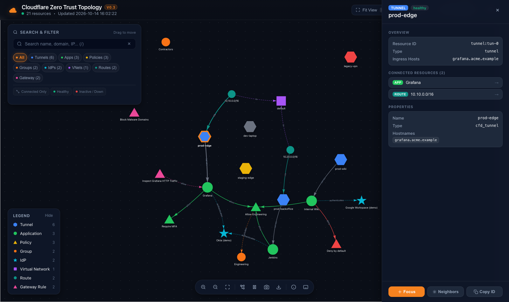

# Cloudflare Zero Trust Network Topology Mapper

<p align="center">
  
  
  
  
</p>

Interactive network topology visualizer and JSON exporter for **Cloudflare Zero Trust** — powered by the **Cloudflare REST API** or **Cloudflare's remote MCP server (`https://mcp.cloudflare.com/mcp`)**.

**[→ Live Demo (cloudflare-topology.pages.dev)](https://cloudflare-topology.pages.dev)**

<p align="center">
  
</p>

## ✨ What It Maps

| Resource | Details |
|----------|---------|
| **Tunnels** | Connector status, colos, ingress hostnames, origin services |
| **Access Applications** | Self-hosted & SaaS apps, domains, session duration |
| **Access Policies & Groups** | Allow / deny / bypass rules, include / exclude / require criteria |
| **Virtual Networks & Routes** | Private network segments and CIDR routes per tunnel |
| **Identity Providers** | Okta, Azure AD, Google Workspace, GitHub, SAML/OIDC |
| **WARP Devices & Gateway Rules** | Enrolled devices and DNS/HTTP firewall rules |

**UI Controls:** Search (`/` or `⌘K`) • Type & Health Filters (`Connected Only`, `Healthy`, `Inactive / Down`) • Node Inspector with Neighbor Navigation • Force & Hierarchical Layouts (`H`) • Export PNG (`E`) & JSON (`J`).

---

## 🚀 Quick Start

```bash
git clone https://github.com/dautovri/cloudflare-topology.git
cd cloudflare-topology
pip install -r requirements.txt
```

### 1. Authenticate (pick one)

- **Zero-config (Wrangler or `cloudflared`):**
  ```bash
  wrangler login                # or `cloudflared tunnel login`
  python main.py                # auto-discovers ~/.wrangler token or ~/.cloudflared/cert.pem
  ```
- **API Token (`.env` or environment variable):**
  ```bash
  python main.py --setup        # interactive wizard: writes .env
  # or
  export CLOUDFLARE_API_TOKEN="your-token"
  ```
  Required token permissions ([Create API Token](https://dash.cloudflare.com/profile/api-tokens)): `Account → Zero Trust: Read` and `Account → Access: Apps and Policies: Read`.

### 2. Generate Topology

```bash
python main.py                              # Direct REST API (default), opens in browser
python main.py --source mcp                 # Fetch via https://mcp.cloudflare.com/mcp
python main.py --demo                       # Synthetic demo data (no API token needed)
python main.py --include-gateway            # Include Gateway DNS/HTTP firewall rules
python main.py --export-json topology.json  # Export structured JSON alongside HTML
```

---

## ⚙️ CLI & Configuration

```text
python main.py [OPTIONS]

  --source {rest,mcp,demo}  Data transport (default: rest; overrides TOPOLOGY_SOURCE)
  --mcp-url URL             Custom MCP endpoint (default: https://mcp.cloudflare.com/mcp)
  --output, -o FILE         Output HTML file (default: network_topology.html)
  --export-json FILE        Export topology + graph data as JSON
  --config, -c FILE         Load settings from a .json or .toml file
  --account-id ID           Cloudflare account ID (repeatable or comma-separated)
  --include-gateway         Include Gateway firewall rules
  --no-devices              Skip WARP devices (faster on large accounts)
  --no-tunnel-configs       Skip per-tunnel ingress configs (faster)
  --no-physics              Disable initial force-layout physics
  --no-browser              Don't open browser after generation
  --demo                    Shorthand for --source demo
  --setup                   Interactive .env setup wizard
  --debug                   Verbose logging
```

| Environment Variable | Default | Description |
|----------------------|---------|-------------|
| `CLOUDFLARE_API_TOKEN` | auto-discover* | API token with Zero Trust read permissions |
| `CLOUDFLARE_ACCOUNT_ID` | auto-discover | Account ID (comma-separated for multi-account) |
| `TOPOLOGY_SOURCE` | `rest` | `rest`, `mcp`, or `demo` |
| `CLOUDFLARE_MCP_URL` | `https://mcp.cloudflare.com/mcp` | MCP server URL |
| `REGEN_INTERVAL_SECONDS` | `900` | Docker background refresh interval (`0` disables) |
| `REGEN_AUTH_TOKEN` | *(unset)* | Bearer token for `POST /regenerate` in Docker |

\* Auto-discovered if `wrangler login` or `~/.cloudflared/cert.pem` is present.

---

## 🐳 Docker & Self-Hosting

```bash
export CLOUDFLARE_API_TOKEN="your-token"
make build && make run
# Serves at http://localhost:8080 (auto-regenerates every 15m)
```

- **Endpoints:** `GET /` (topology UI), `GET /health` (freshness JSON), `POST /regenerate` (Bearer `REGEN_AUTH_TOKEN`, returns `202 Accepted`).
- **Cloudflare Pages deploy:**
  ```bash
  PAGES_PROJECT=my-cf-topology make deploy-demo   # synthetic demo
  PAGES_PROJECT=my-cf-topology make deploy        # real data (protect behind Cloudflare Access!)
  ```

---

## 🧪 Development

```bash
make test   # pytest (119 tests)
make lint   # flake8 + mypy
```

## 📜 License

Apache 2.0 — see [LICENSE](LICENSE). Inspired by [tailscale-network-topology-mapper](https://github.com/SimplyMinimal/tailscale-network-topology-mapper).
